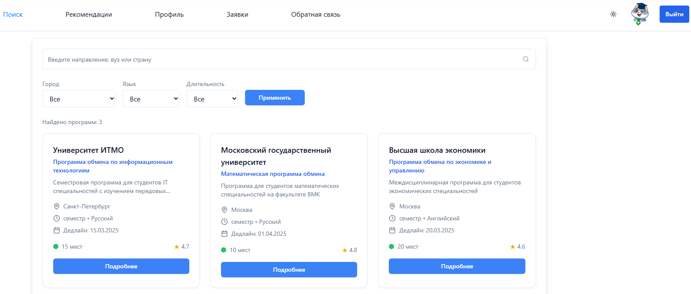
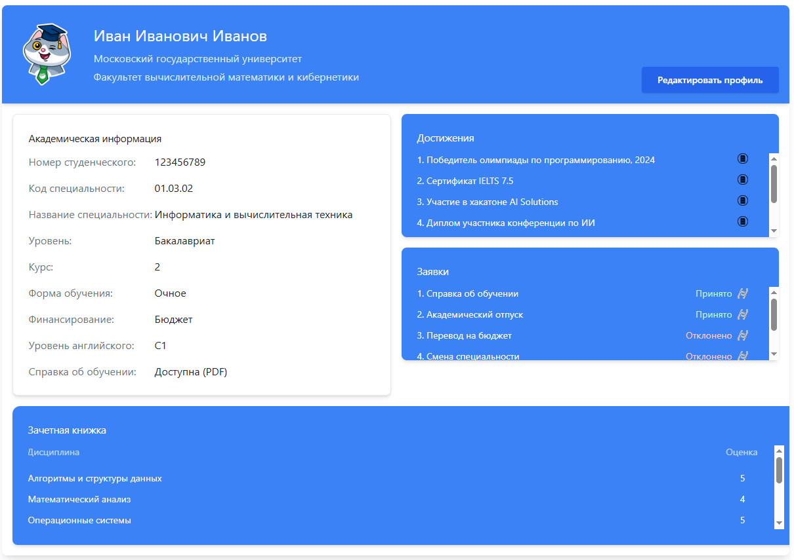

# 🎓 University Student Exchange Platform

A web-based prototype derived from the design of a case championship solution - ["Sberbank and ITMO championship within the framework of the forum 'It's up to you to decide'."](https://github.com/PavelGld/Designing-a-platform-for-inter-university-student-exchange)

The task involved developing a concept for a digital platform for inter-university student exchange. In this task, analytical efforts were made to define the problem statement, conduct research on relevance and demand, and propose methods for automating the platform using AI.





## 🌟 Features

### Core Functionality
- **Exchange Program Search** - Browse and filter university exchange programs
- **AI Course Recommendations** - Personalized course suggestions using machine learning
- **Student Profile Management** - Comprehensive student information system
- **Application Tracking** - Monitor application status and deadlines
- **Dark/Light Mode** - Full theme support with system preference detection

### Technical Features
- **Full-Stack TypeScript** - Type-safe development across frontend and backend
- **Modern React** - Built with React 18+ and functional components
- **Responsive Design** - Mobile-first approach with Tailwind CSS
- **Real-time Updates** - Live data synchronization with TanStack Query
- **AI Integration** - OpenRouter LLM and vector embeddings for recommendations

## 🚀 Quick Start

### Prerequisites
- Node.js 18+ installed
- PostgreSQL database (automatically configured on Replit)

### Installation & Setup

1. **Clone and Install Dependencies**
```bash
npm install
```

2. **Database Setup**
The PostgreSQL database is automatically configured. To seed with sample data:
```bash
curl -X POST http://localhost:5000/api/seed
```

3. **Start Development Server**
```bash
npm run dev
```

The application will be available at `http://localhost:5000`

## 📱 Application Pages

### 🔍 Search Page (Main)
- Search university exchange programs
- Filter by city, language, and duration
- View program details and university information
- Dark mode optimized cards

### 🧠 AI Recommendations
- Personalized course recommendations
- ML-powered matching based on student profile
- Detailed reasoning for each recommendation
- Generate new recommendations with one click

### 👤 Student Profile
- View complete academic information
- Student ID, specialty, and course details
- Achievement gallery with document links
- Application history and status

### ✏️ Profile Editor
- Add/edit course information
- Manage student achievements
- Update academic records
- Real-time validation

### 📋 Applications
- Track all submitted applications
- Status monitoring (Pending, Approved, Rejected)
- Application history with dates
- Submit new applications

### 💬 Feedback System
- Contact form with categories
- Technical support information
- FAQ section
- Multi-category message routing

## 🏗️ Architecture

### Frontend Stack
```
React 18 + TypeScript
├── Vite (Build tool)
├── Tailwind CSS (Styling)
├── shadcn/ui (Component library)
├── Wouter (Routing)
├── TanStack Query (State management)
└── Framer Motion (Animations)
```

### Backend Stack
```
Express.js + TypeScript
├── Drizzle ORM (Database)
├── PostgreSQL (Database)
├── Zod (Validation)
├── OpenRouter (AI/LLM)
└── Vector Embeddings (AI Recommendations)
```

### Project Structure
```
├── client/                 # Frontend React application
│   ├── src/
│   │   ├── components/     # Reusable UI components
│   │   ├── pages/          # Application pages
│   │   ├── lib/            # Utilities and configurations
│   │   └── hooks/          # Custom React hooks
├── server/                 # Backend Express application
│   ├── routes.ts           # API endpoints
│   ├── storage.ts          # Database operations
│   ├── aiService.ts       # AI/ML integration
│   └── seedData.ts        # Sample data generation
├── shared/                 # Shared types and schemas
│   └── schema.ts          # Database schema and validation
└── public/                # Static assets
```

## 🎨 Design System

### Theme Support
The application supports both light and dark themes with:
- CSS custom properties for dynamic theming  
- Automatic system preference detection
- Manual theme toggle in navigation
- Consistent component styling across themes

### Color Palette
```css
/* Light Theme */
--background: hsl(0 0% 100%)
--foreground: hsl(222.2 84% 4.9%)
--primary: hsl(221.2 83.2% 53.3%)

/* Dark Theme */  
--background: hsl(222.2 84% 4.9%)
--foreground: hsl(210 40% 98%)
--primary: hsl(217.2 91.2% 59.8%)
```

## 🤖 AI Integration

### Course Recommendations
The platform uses advanced AI to provide personalized course recommendations:

1. **Vector Embeddings** - Course descriptions converted to semantic vectors
2. **Student Profiling** - Academic history and preferences analysis
3. **Similarity Matching** - Find courses matching student interests
4. **LLM Enhancement** - Generate detailed explanations and reasoning

### API Integration
```typescript
// Generate recommendations
POST /api/students/{id}/generate-recommendations

// Get existing recommendations  
GET /api/students/{id}/recommendations
```

## 🗄️ Database Schema

### Key Tables
- **students** - Student profiles and academic information
- **universities** - Partner university data
- **exchange_programs** - Available exchange programs
- **courses** - Course catalog with AI embeddings
- **recommendations** - AI-generated course suggestions
- **applications** - Student application tracking

### Relationships
```sql
students ← student_courses → courses
students ← applications → exchange_programs → universities
students ← recommendations → courses → exchange_programs
```

## 🔧 Development

### Available Scripts
```bash
npm run dev          # Start development server
npm run build        # Build for production
npm run db:push      # Push schema changes to database
npm run db:generate  # Generate migration files
```

### Environment Variables
```bash
DATABASE_URL=         # PostgreSQL connection string
OPENROUTER_API_KEY=   # AI service API key (optional)
AITUNNEL_API_KEY=     # Vector embedding service (optional)
```

## 🚀 Deployment

### Replit Deployment
1. Click the "Deploy" button in Replit
2. The application will be automatically built and deployed
3. Environment variables are configured automatically
4. Database migrations run automatically

### Manual Deployment
1. Build the application: `npm run build`
2. Set up PostgreSQL database
3. Configure environment variables
4. Run database migrations: `npm run db:push`
5. Start the server: `npm start`

## 📊 Performance

### Frontend Optimizations
- Code splitting with dynamic imports
- Image optimization and lazy loading
- Component memoization where appropriate
- Efficient state management with TanStack Query

### Backend Optimizations  
- Database connection pooling
- Query optimization with Drizzle ORM
- Caching for AI recommendations
- Request validation with Zod schemas

## 🔐 Security

### Data Protection
- Input validation on all endpoints
- SQL injection prevention with ORM
- XSS protection with React
- CORS configuration for production

### Authentication Ready
The platform is designed to integrate with authentication systems:
- User session management structure
- Role-based access control ready
- Secure API endpoint patterns

## 🛠️ Customization

### Adding New Pages
1. Create component in `client/src/pages/`
2. Add route in `client/src/App.tsx`
3. Update navigation in `client/src/components/Navigation.tsx`

### Database Changes
1. Update schema in `shared/schema.ts`
2. Run `npm run db:push` to apply changes
3. Update storage interface in `server/storage.ts`
4. Add API endpoints in `server/routes.ts`

### Styling Modifications
- Update theme variables in `client/src/index.css`
- Modify component styles with Tailwind classes
- Customize shadcn/ui components as needed

## 📈 Future Enhancements

### Planned Features
- [ ] Real-time notifications
- [ ] Document upload system
- [ ] Video call integration
- [ ] Mobile app development
- [ ] Advanced analytics dashboard

### AI Improvements
- [ ] Multi-language support for recommendations
- [ ] Personality-based course matching
- [ ] Career path optimization
- [ ] Predictive academic success modeling

## 🤝 Contributing

### Development Workflow
1. Fork the repository
2. Create feature branch (`git checkout -b feature/amazing-feature`)
3. Commit changes (`git commit -m 'Add amazing feature'`)
4. Push to branch (`git push origin feature/amazing-feature`)
5. Open Pull Request

### Code Style
- TypeScript strict mode enabled
- ESLint configuration provided
- Prettier formatting recommended
- Comment important business logic

## 📞 Support

### Technical Issues
- Check the console for error messages
- Verify database connection
- Ensure all dependencies are installed
- Review environment variable configuration

### Feature Requests
- Open an issue with detailed description
- Include use cases and expected behavior
- Provide mockups or examples if applicable

## 📄 License

This project is licensed under the MIT License - see the [LICENSE](LICENSE) file for details.

## 🙏 Acknowledgments

- **shadcn/ui** - Beautiful UI components
- **Tailwind CSS** - Utility-first CSS framework  
- **Drizzle ORM** - Modern TypeScript ORM
- **OpenRouter** - AI/LLM integration platform
- **Replit** - Development and hosting platform

---

Built with ❤️ for modern university exchange programs